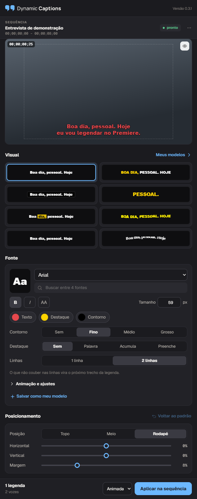

<picture>
  <source media="(prefers-color-scheme: dark)" srcset="assets/logo-dark.svg">
  
</picture>

<strong>Transforme a fala em legendas animadas na timeline.</strong>

<a href="https://github.com/eusouored/dynamic-captions/releases/latest"><strong>Baixar para Windows</strong></a>

Windows 10 ou 11 (64 bits) · Adobe Premiere Pro 25 ou mais recente

Plugin para o Adobe Premiere Pro que transcreve a fala, separa as vozes e cria legendas animadas direto na timeline. A transcrição roda no seu computador, num motor local em Python. Nenhum áudio é enviado para servidores.

## Instalar

1. Baixe `Instalar-Dynamic-Captions-<versão>.exe` na [versão mais recente](https://github.com/eusouored/dynamic-captions/releases/latest).
2. Execute e siga as telas. Na primeira vez, o instalador baixa o Python, as bibliotecas e os modelos que o seu computador vai usar: com placa NVIDIA, cerca de 3 GB de bibliotecas e até 7 GB de modelos.
3. No Premiere: **Janela › Extensões › Dynamic Captions**.

O passo a passo completo, os problemas comuns e a desinstalação estão em [LEIA-ME.txt](LEIA-ME.txt).

### Requisitos

- Windows 10 ou 11 (64 bits)
- Adobe Premiere Pro 25 (2025) ou mais novo
- Internet durante a instalação e uns 15 GB livres no disco C:
- Recomendado: placa NVIDIA com 8 GB ou mais (também funciona sem, só que mais devagar)

## Interface

<picture>
  <source media="(prefers-color-scheme: light)" srcset="assets/interface-light.png">
  
</picture>

<em>Compare estilos e ajuste a tipografia e a posição na prévia da legenda.</em>

Capturas com dados de demonstração · <a href="assets/interface-dark.png">Tema escuro</a> · <a href="assets/interface-light.png">Tema claro</a>

## Estrutura

| Pasta | O que é |
|---|---|
| `painel/` | Painel CEP do Premiere (interface e ExtendScript) |
| `motor/` | Motor local em Python: transcrição, separação de vozes, legendas e renderização |
| `instalador/` | Scripts do instalador (`instalar.ps1`, `runtime-producao.ps1`, `desinstalar.ps1`) |

## Separação de vozes e uso comercial

O instalador pergunta como o plugin vai ser usado:

- **Uso pessoal:** pode usar o SUPlime, o separador de vozes mais preciso. Os pesos dele são CC BY-NC 4.0 (sem uso comercial) e exigem uma conta grátis na Hugging Face.
- **Trabalho pago:** usa só separadores com licença comercial e não precisa de conta.

## Licença

Código do Dynamic Captions: MIT com a "Commons Clause" v1.0 ([LICENSE.txt](LICENSE.txt)). Pode usar, estudar, modificar e redistribuir, mas não pode vender o software nem um serviço cujo valor venha dele.

Os modelos, o Python e as bibliotecas **não** fazem parte deste repositório. O instalador baixa cada um da fonte oficial. As licenças de cada um e as regras de uso estão em [TERCEIROS.txt](TERCEIROS.txt).

Adobe e Premiere Pro são marcas registradas ou marcas da Adobe nos Estados Unidos e/ou em outros países. O Dynamic Captions é um projeto independente: não é desenvolvido, afiliado, endossado nem patrocinado pela Adobe.

## Outros plugins Dynamic

[Dynamic Anchor](https://github.com/eusouored/dynamic-anchor) · [Dynamic Cut](https://github.com/eusouored/dynamic-cut)
